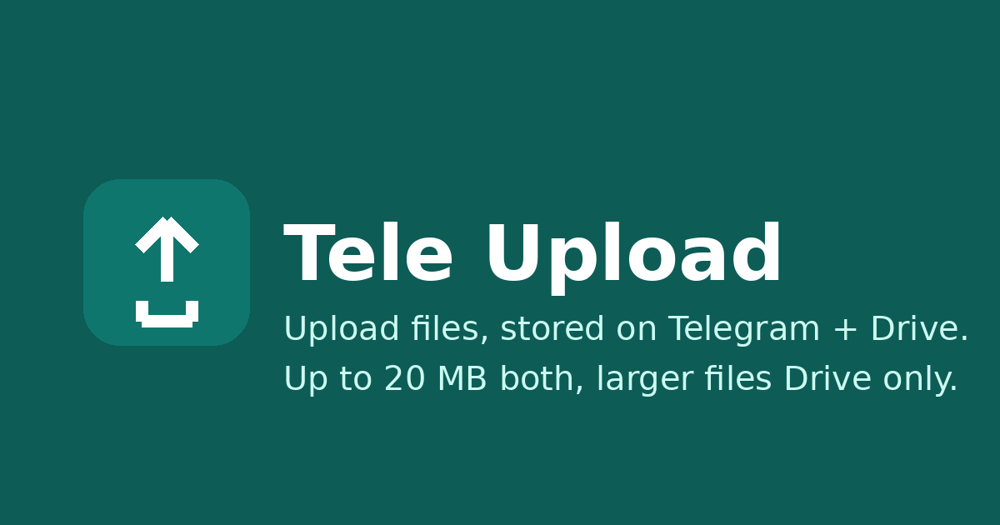
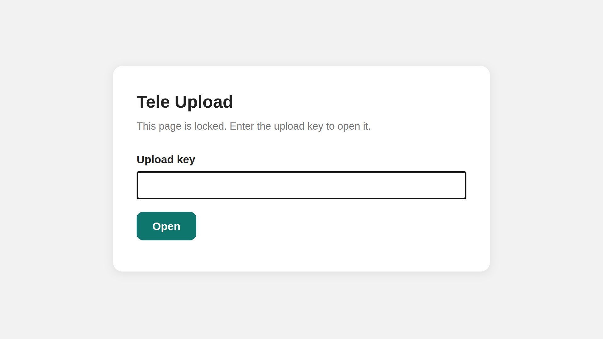

# Tele Upload

A web file uploader backed by Telegram and Google Drive, running on Cloudflare Workers. The website is the only UI: upload, list, download, and delete files from one page. File bytes live in Telegram (and, as a mirror, in Google Drive). Downloads are proxied through the server, so the bot token never reaches the browser.

Live: https://upload.xsrazy.web.id/

## Screenshots

The site is locked behind an upload key, so the public face of the website is the lock page:

*The lock page: every visitor sees the key form first. The uploader itself lives behind the key.*

## About

Tele Upload is a single-page web app for storing files in places you already trust. Upload a file and it is sent to a Telegram chat via the Bot API while its metadata (name, size, Telegram `file_id`, message id, Drive id) is stored in Cloudflare D1. Every upload is also mirrored to Google Drive. Downloads stream back through the Worker, either from Telegram's `getFile` or from the Drive API, so no token or credential ever ships to the browser.

The web UI itself is in English. The project is dependency-free: one Worker script, one D1 database, and a folder of static assets.

## Features

- **Multi-file upload** — the form accepts many files at once; they are sent one by one with a ~1.2 second gap, and the page reports a per-file status line (`OK` / `Failed`) plus a success/failure count. Each file shows a real percent progress, the selected files are previewed first with sizes and a Drive-only tag for files over 20 MB, and the upload button is disabled while a batch runs so a double submit cannot duplicate files. If the session expires mid-batch, the files uploaded so far are shown before the page reloads to the key form.
- **File list** — the index is read from D1, newest first, showing filename and human-readable size, with a **Download** link and a red **Delete** button that asks for confirmation first. The list is paginated (`limit`/`offset`, default 100, max 200) with a `total` count and a Load more button, so older files never disappear from the UI.
- **Telegram + Drive mirror** — files up to 20 MB go to Telegram **and** Drive. Files over 20 MB go to **Drive only** (Telegram is skipped, because bot downloads via `getFile` are capped at 20 MB), up to a 100 MB Drive-only cap. A file over 20 MB is rejected when Google credentials are not configured, so it can never end up stored nowhere. The browser refuses files over 100 MB before uploading.
- **Drive failures never fail uploads** — if the Drive mirror fails, the Telegram upload still succeeds and `drive_error` is reported in the response instead. Failed saves are cleaned up too: if the D1 record cannot be stored after Telegram accepted the file, the Telegram message is removed again, and if the Drive reference cannot be stored, the Drive copy is removed again, so failed uploads leave no orphaned copies behind.
- **Telegram 429 auto-retry** — when Telegram rate-limits, the Worker waits `retry_after` (capped at 30 seconds) and retries once (the request body is rebuilt for the retry).
- **Locked page** — opening the site shows a key form first. A correct key sets an HttpOnly session cookie valid for 30 days (stored in D1 as `session:<token>`). Login is rate limited: 5 wrong keys from one IP within 15 minutes returns 429, and expired sessions are cleaned up on every successful login. Every API endpoint accepts the upload key header (`x-upload-key`) or the session cookie and returns 401 without either; the frontend reloads back to the lock page on 401. Logout clears the current session, and a separate log-out-everywhere clears every session on all devices.
- **Delete kills the link** — deleting removes the Telegram message, the Drive copy (when present), and the D1 row, so the download link dies too. The Drive deletion result is checked: if it fails, the row is kept and the API answers 502 so the delete can be retried. The response reports `telegram_deleted` and `drive_deleted`.
- **Proxied downloads** — files stream through the Worker with a sanitized filename, from Drive for Drive-only files and from Telegram otherwise. If the Telegram copy fails and a Drive copy exists, the download falls back to Drive automatically. Downloads support HTTP Range (resume, 206) and non-ASCII filenames are sent with a UTF-8 `filename*` parameter. A browser click on a download with an expired session gets a friendly "Session expired" page that redirects to login instead of raw JSON.
- **Full SEO metadata** — description, keywords, canonical URL, theme color, Open Graph + Twitter cards, and a JSON-LD `WebApplication` block, all served from the Worker. Favicons and the OG image are generated by `gen_assets.py` (teal upload-arrow branding).

## Architecture

| Layer | Implementation |
|---|---|
| Edge runtime | Cloudflare Worker, `src/index.js` (zero dependencies, Web APIs + `fetch` only) |
| Database | Cloudflare D1, binding `DB` (`files` + `settings` tables, see `schema.sql`) |
| File storage | Telegram Bot API (`sendDocument`, `getFile`, `deleteMessage`) |
| Mirror storage | Google Drive API v3 (OAuth refresh flow, `drive.file` scope, multipart upload) |
| Static assets | `public/` served through the `ASSETS` binding (favicons, OG image, bot profile) |
| Deploy config | `wrangler.toml` (`workers_dev = false`, so the Worker serves only the custom domain) |

The `files` table holds one row per upload: id, filename, mime, size, Telegram `file_id`, Telegram `message_id`, creation timestamp, and the Drive file id (null for Telegram-only rows). The `settings` table holds session tokens (`session:<token>` → expiry), login rate-limit counters (`ratelimit:<ip>` → count + window), and the auto-created Drive folder id.

## API

All endpoints except `/api/login` require the upload key header (`x-upload-key`) or the session cookie, and return `401` without either.

| Method & path | Description | Rules |
|---|---|---|
| `POST /api/login` | JSON body `{key}`. On a correct key, sets the HttpOnly `tu_session` cookie (30 days) and stores `session:<token>` in D1. | Wrong key → error, no cookie. 5 wrong keys from one IP within 15 minutes → 429. |
| `POST /api/logout` | Clears the session cookie and removes the session from D1. | — |
| `POST /api/logout-all` | Removes every session from D1 and clears the cookie, logging out all devices. | — |
| `GET /api/list` | Returns the file index from D1, newest first, paginated with `limit`/`offset` (default 100, max 200) and a `total` count. | — |
| `POST /api/upload` | Multipart form with one `file` field. Sends the file to Telegram (unless Drive-only) and mirrors it to Drive. Returns the download URL, plus `drive_only` for Drive-only files and `drive_error` when the mirror failed. | ≤ 20 MB → Telegram + Drive. > 20 MB → Drive only, rejected when Google credentials are missing. > 100 MB → rejected. Telegram 429 → wait `retry_after` (max 30 s), retry once. |
| `GET /api/download/:id` | Streams the file back through the Worker. | Drive API for Drive-only files, Telegram `getFile` otherwise. Telegram failure falls back to Drive when a copy exists. Supports Range (206) and UTF-8 filenames. Filename is sanitized for the download header. |
| `DELETE /api/delete/:id` | Deletes the Telegram message, the Drive copy (when present), and the D1 row. | The download link dies with the row. A failed Drive delete keeps the row and returns 502; the response reports `telegram_deleted` and `drive_deleted`. |

## Environment Variables

Names only, never values. Secrets are set with `wrangler secret put`.

| Variable | Purpose |
|---|---|
| `TELEGRAM_BOT_TOKEN` | Bot token from @BotFather. |
| `TELEGRAM_CHANNEL_ID` | The chat the bot sends files to (a private chat works; the bot must be able to post there). |
| `UPLOAD_KEY` | The key that unlocks the page and authorizes uploads. |
| `GOOGLE_CLIENT_ID` | OAuth client id for the Drive mirror (Desktop app client, `drive.file` scope, offline access). |
| `GOOGLE_CLIENT_SECRET` | OAuth client secret for the Drive mirror. |
| `GOOGLE_REFRESH_TOKEN` | OAuth refresh token for the Drive mirror. |
| `DRIVE_FOLDER_ID` | Optional target Drive folder. Without it, the Worker creates its own `Upload-tele` folder and remembers it in D1. |

The D1 `database_id` in `wrangler.toml` is censored with `******` in this repository; use your own id from `wrangler d1 create`.

## Deploy

1. `wrangler d1 create tele-upload` (put the real database id in `wrangler.toml`; the id in this repo is censored).
2. `wrangler d1 execute tele-upload --remote --file schema.sql`
3. `wrangler secret put TELEGRAM_BOT_TOKEN TELEGRAM_CHANNEL_ID UPLOAD_KEY` (plus the Google secrets for the Drive mirror).
4. `wrangler deploy`

## Limits

- Telegram bots can send up to 50 MB, but bot downloads via `getFile` are capped at 20 MB per file. That is why the Telegram path stops at 20 MB.
- Drive-only files are capped at 100 MB.
- Telegram allows roughly 1 message per second per chat, so bulk uploads are throttled on purpose (1.2 s gap on the client, `retry_after` handling on the server).
- The Worker runs on the Cloudflare free tier (100k requests per day).

## Security notes

- Uploads require the key. Without it, anyone could park files in the Telegram chat.
- The bot token and Google credentials live only as Worker secrets, never in this repository. Values that would identify private infrastructure are censored with `******` in this repo.
- Never delete the Telegram chat messages by hand: the messages are the files.

## Notes

- The repository's existing `README.md` was replaced by this document; the project itself is unchanged.
- The lock-page screenshot in this README was supplied by the project owner; the uploader UI behind the key is not publicly screenshottable without the upload key.

## Credits

Tele Upload is an original project by Rahmatul Usra (@xsrazy), built from scratch.

## License

MIT. See [LICENSE](LICENSE).
